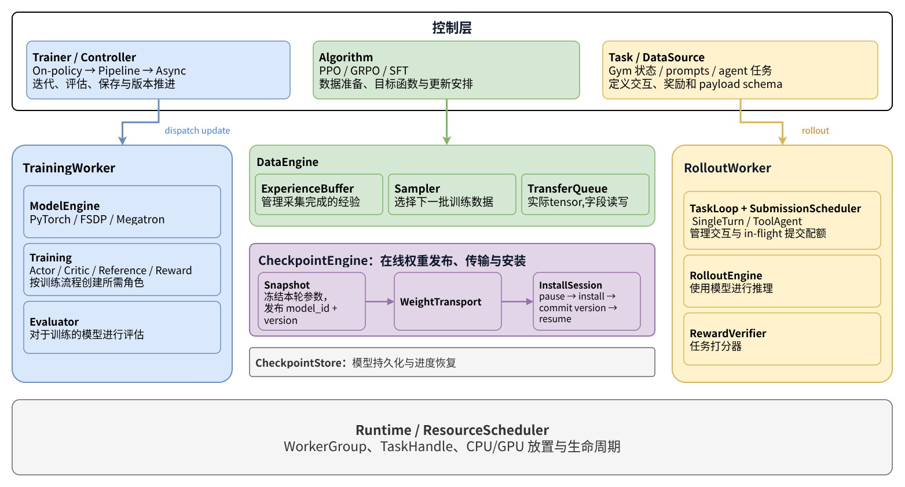

# mini-RL-Framework



从零构建的轻量级大语言模型强化学习（LLM RL）训练框架，集成 [`mini-sglang`](./mini-sglang) 推理引擎与 [`mini-megatron`](./mini-megatron) 训练后端，实现采样、数据流转、策略更新、在线权重同步与断点持久化的完整闭环。

## 核心特性

- **分层解耦架构**：将控制层（Controller / Algorithm / Task）、执行与数据层（TrainingWorker / DataEngine / RolloutWorker / CheckpointEngine）与运行时调度（Runtime / ResourceScheduler）清晰分离。
- **GRPO 训练闭环**：内置组内优势归一化、PPO-Clip 裁剪损失与可选 Reference KL 约束，支持跨 Epoch / Minibatch 更新与无副作用周期评估（`Evaluator`）。
- **在线权重同步**：对接 `mini-sglang` 采样生成 Token 与逐位置 `logprob`，通过 `CheckpointEngine` 在线同步最新 Actor 权重并追踪策略版本（`weight_version`）。
- **多卡与异构放置**：独立配置 Training / Rollout 设备，训练按样本做数据并行，采样请求并发分发到多个副本，在线权重逐张量跨设备传输。
- **原子化状态持久化**：`CheckpointStore` 支持模型、优化器、全链路 RNG 状态与数据读取进度的原子保存与恢复。

## 目录结构

```text
mini-RL-Framework/
├── mini-megatron/          # 轻量级 PyTorch 训练后端 (ModelEngine, Trainer)
├── mini-sglang/            # 轻量级推理引擎子模块 (Paged KV Cache, RadixCache)
├── sample/                 # 示例任务与配置 (basic_arithmetic)
├── scripts/                # 环境自检脚本 (check_env.py)
├── src/
│   ├── algorithms/         # RL 算法实现 (GRPO)
│   ├── core/               # 核心组件 (Runtime, Rollout, DataEngine, Training, Checkpoint)
│   ├── observability/      # 日志、概率一致性诊断与 Trace 导出
│   ├── tasks/              # 数据源加载与模板渲染 (PromptSource / EvalSource)
│   ├── config.py           # TOML 实验配置解析
│   ├── train.py            # 训练入口
│   └── types.py            # 模块间数据契约
└── tests/                  # 单元测试
```

## 快速开始

```bash
# 1. 初始化子模块与环境 (Python 3.13 + uv)
git submodule update --init --recursive
uv sync
uv run python scripts/check_env.py

# 2. 启动示例训练 (需先将 sample/basic_arithmetic/model 指向本地 HF 模型目录)
uv run python -m src.train sample/basic_arithmetic

# 3. 运行单元测试
uv run python -m unittest discover -s tests
```

## GPU 放置与并行

在任务的 `config.toml` 中分别指定训练和采样设备。以下配置使用两张卡，训练与 Rollout 各占一张：

```toml
[resources]
training_devices = ["cuda:0"]
rollout_devices = ["cuda:1"]

[training]
learning_rate = 0.00001
minibatch_size = 4
update_epochs = 1
eval_every = 1
dtype = "bfloat16"
```

设备编号遵循 `CUDA_VISIBLE_DEVICES`。未配置 `[resources]` 时，两侧沿用 `cuda:0`；CPU 训练可设置 `training_devices = ["cpu"]`。不同角色可放在不同型号的 CUDA GPU 上，也可共享设备。

`training_devices` 指定多张 CUDA GPU 时，`ResourceScheduler` 使用 PyTorch `DataParallel` 分发 minibatch。每张卡计算逐 token 的 logprob，在首张卡上计算完整 minibatch 的 GRPO loss，并归并梯度。组内优势在切分前计算；末尾不足整批的样本照常训练。首张训练卡保存模型和优化器状态，其他训练卡保存计算副本。这是单机数据并行，模型需要完整放入每张训练卡。

`rollout_devices` 指定多张卡时，每张卡加载一个 mini-sglang 副本，请求并行执行，结果保持输入顺序。同步和评估会向全部副本安装同一版本，再开始下一次采样。后端在安装后清空旧 KV cache。设备列表显式决定放置，不根据显存自动迁移。

在线同步读取训练设备上的参数，逐张量传入目标设备，不生成整模型 CPU 快照或磁盘文件。跨 GPU 复制由 PyTorch 处理；CPU 来源使用 pinned memory 传输。`TrainingWorker.export_weights()` 仍返回独立 CPU 快照，在线同步与评估使用 `export_weights(cpu=False)`。

双卡验证复用本地 Llama 模型目录：

```bash
CUDA_VISIBLE_DEVICES=0,1 MINI_RL_MODEL_DIR=/path/to/local/llama \
  uv run python -m unittest discover -s tests -p test_disaggregated_gpu.py
CUDA_VISIBLE_DEVICES=0,1 \
  uv run python -m unittest discover -s tests -p test_multi_gpu.py
```

验证覆盖分离训练与采样、跨卡权重安装、安装后的版本与缓存、多个采样副本，以及不均匀 minibatch 与单卡训练结果的一致性。

## TODO

- [ ] **异步 RL**：解耦采样与训练的同步阻塞，完善 `ExperienceBuffer` / `TransferQueue` 异步流水线、策略版本滞后控制与无损在线权重热更新。
- [ ] **Web Panel 与 Trace**：完善 `observability` 模块与 Chrome Trace 导出，构建可视化 Web 面板以追踪阶段耗时时间线（Trace）、`logprob` 一致性与训练指标。

## License

[MIT License](./LICENSE)
