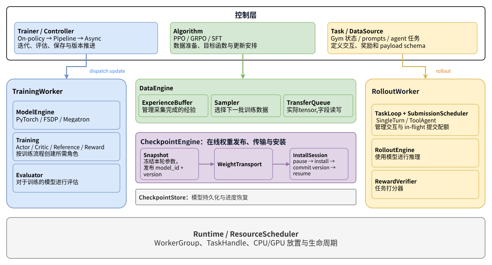

# mini-RL-Framework



从零构建的轻量级大语言模型强化学习（LLM RL）训练框架，集成 [`mini-sglang`](./mini-sglang) 推理引擎与 [`mini-megatron`](./mini-megatron) 训练后端，实现采样、数据流转、策略更新、在线权重同步与断点持久化的完整闭环。

## 核心特性

- **分层解耦架构**：将控制层（Controller / Algorithm / Task）、执行与数据层（TrainingWorker / DataEngine / RolloutWorker / CheckpointEngine）与运行时调度（Runtime / ResourceScheduler）清晰分离。
- **GRPO 训练闭环**：内置组内优势归一化、PPO-Clip 裁剪损失与可选 Reference KL 约束，支持跨 Epoch / Minibatch 更新与无副作用周期评估（`Evaluator`）。
- **在线权重同步**：对接 `mini-sglang` 采样生成 Token 与逐位置 `logprob`，通过 `CheckpointEngine` 在线同步最新 Actor 权重并追踪策略版本（`weight_version`）。
- **原子化状态持久化**：`CheckpointStore` 支持模型、优化器、全链路 RNG 状态与数据读取进度的原子保存与恢复。

## 目录结构

```text
mini-RL-Framework/
├── mini-megatron/          # 轻量级 PyTorch 训练后端 (ModelEngine, Trainer)
├── mini-sglang/            # 轻量级推理引擎子模块 (Paged KV Cache, RadixCache)
├── sample/                 # 示例任务与配置 (basic_arithmetic)
├── scripts/                # 环境自检脚本 (check_env.py)
├── src/
│   ├── algorithms/         # RL 算法实现 (GRPO)
│   ├── core/               # 核心组件 (Runtime, Rollout, DataEngine, Training, Checkpoint)
│   ├── observability/      # 日志、概率一致性诊断与 Trace 导出
│   ├── tasks/              # 数据源加载与模板渲染 (PromptSource / EvalSource)
│   ├── config.py           # TOML 实验配置解析
│   ├── train.py            # 训练入口
│   └── types.py            # 模块间数据契约
└── tests/                  # 单元测试
```

## 快速开始

```bash
# 1. 初始化子模块与环境 (Python 3.13 + uv)
git submodule update --init --recursive
uv sync
uv run python scripts/check_env.py

# 2. 启动示例训练 (需先将 sample/basic_arithmetic/model 指向本地 HF 模型目录)
uv run python -m src.train sample/basic_arithmetic

# 3. 运行单元测试
uv run python -m unittest discover -s tests
```

## TODO

- [ ] **异步 RL**：解耦采样与训练的同步阻塞，完善 `ExperienceBuffer` / `TransferQueue` 异步流水线、策略版本滞后控制与无损在线权重热更新。
- [ ] **多卡 / 异构支持**：完善 `ResourceScheduler`，支持 Training 与 Rollout 分离式 GPU 放置、多卡并行及跨设备高效权重传输。
- [ ] **Web Panel 与 Trace**：完善 `observability` 模块与 Chrome Trace 导出，构建可视化 Web 面板以追踪阶段耗时时间线（Trace）、`logprob` 一致性与训练指标。

## License

[MIT License](./LICENSE)
